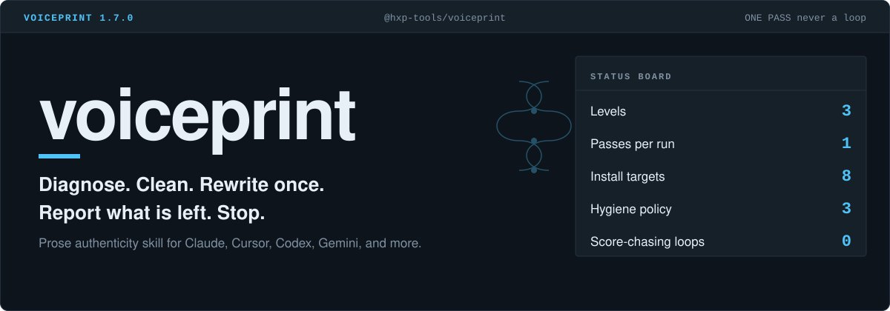
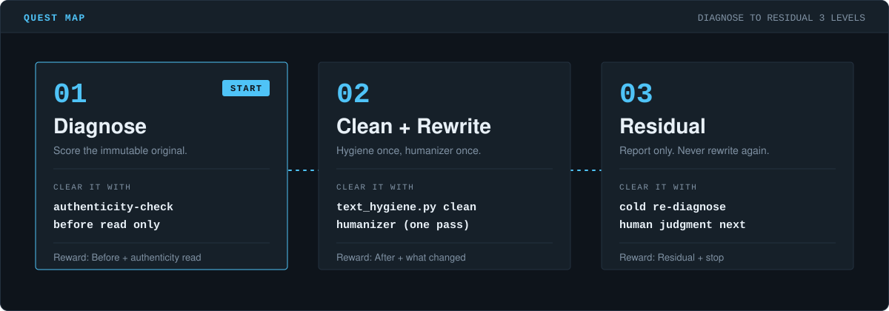
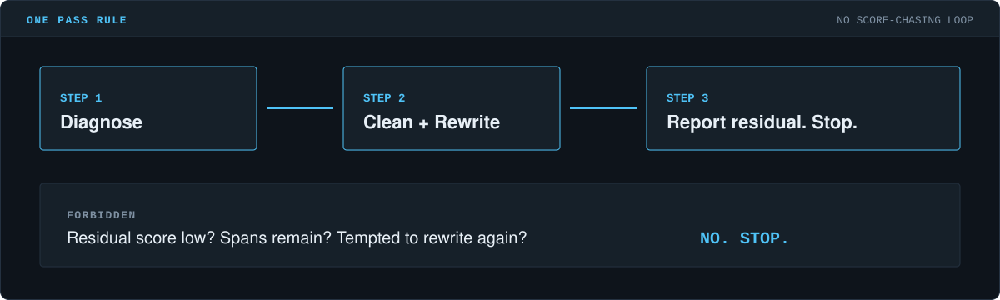
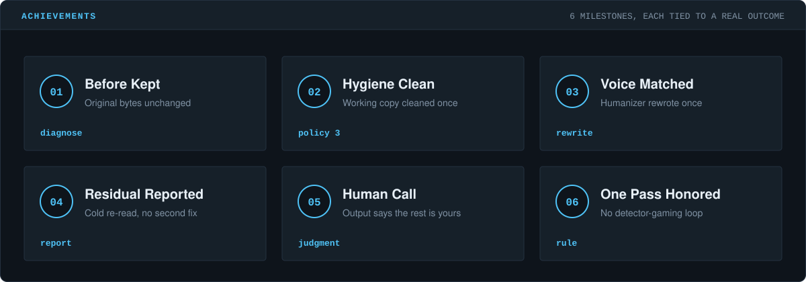

# voiceprint

[](CHANGELOG.md)
[](https://www.npmjs.com/package/@hxp-tools/voiceprint)
[](LICENSE)
[](#one-pass-rule)
[](#supported-tools)



**One-pass prose authenticity for AI coding tools.** You give it text. It
checks how authentically the draft reads, cleans hidden Unicode once, rewrites
the AI tells once, and tells you what is left. Never a loop.

Built from [humanizer](https://github.com/hannsxpeter/humanizer) (rewrite) and
[authenticity-check](https://github.com/hannsxpeter/authenticity-check)
(diagnose). Both stay independently usable upstream; voiceprint composes them
without turning the re-check into another rewrite.

## Quest map



| Level | Mode | Clear it with | Reward |
| --- | --- | --- | --- |
| **01** | **Diagnose** | authenticity-check on the original | Before + authenticity read |
| **02** | **Clean + Rewrite** | `text_hygiene.py clean` then humanizer once | After + what changed |
| **03** | **Residual** | cold re-diagnose, report only | Residual + human's call |

## One-pass rule



1. Diagnose the immutable original once (before read).
2. Clean a working copy once, then humanize once (after text).
3. Re-diagnose once **only to report the residual**.

There is no target score and no "try again until it passes." What remains
after the pass is a human's judgment. voiceprint is not an AI-detector tool
and names no detector.

## Achievements



| Unlock | How you earn it |
| --- | --- |
| Before Kept | Original stays byte-for-byte in `Before` |
| Hygiene Clean | Working copy cleaned once (policy 3) |
| Voice Matched | Humanizer rewrote the AI tells once |
| Residual Reported | Cold re-read with no second fix |
| Human Call | Output states the rest is yours |
| One Pass Honored | No score-chasing rewrite loop |

## Press start

```sh
npx @hxp-tools/voiceprint@latest
```

Or pick a target: `npx @hxp-tools/voiceprint@latest cursor` (also `claude`,
`codex`, `windsurf`, or `all`).

The hygiene helper requires Python 3.11 or newer. Restart your coding agent,
then ask in plain language: clean this up and verify it, make this authentic
and tell me how it scored, or just "voiceprint this."

Half-requests stay half: rewrite-only uses
[humanizer](https://github.com/hannsxpeter/humanizer); score-only uses
[authenticity-check](https://github.com/hannsxpeter/authenticity-check).

## Supported tools

| Tool | Entry file | Notes |
| --- | --- | --- |
| Claude Code | `SKILL.md` | `npx` install or clone into `~/.claude/skills/voiceprint/` |
| Cursor | `.cursor/rules/voiceprint.mdc` | Project rule, or install into `~/.cursor/skills/voiceprint/` |
| Codex / Antigravity / Pi / OpenCode | `AGENTS.md` | Keep the skill tree in the workspace |
| Gemini CLI | `GEMINI.md` | Keep `GEMINI.md` + skill tree in the project |
| GitHub Copilot | `.github/copilot-instructions.md` | Copy adapters + skill tree into the target repo |

Every adapter routes to the same `SKILL.md`, `scripts/text_hygiene.py`, and
`vendor/` tree. The pass pre-approves only read-only tools; pasted text never
reaches a shell command or heredoc.

## How it works

Given text, the skill returns six sections: Before, Authenticity read
(before), After, What changed, Residual, What remains is a human's call.
Hygiene counts land inside `What changed`, never as a seventh section.

Local transformation is only the deterministic Unicode helper at the start of
Step 2. Deep policy (spaces, joiners, emoji tables, directional marks, CLI,
benchmarks) lives in [docs/hygiene.md](docs/hygiene.md). Vendored skill sync
and release steps live in [CONTRIBUTING.md](CONTRIBUTING.md).

`scripts/check` runs everything CI runs. CI runs it on Python 3.11, the documented minimum, and 3.14.

## Scope

voiceprint improves prose quality and authentic voice, then gives an honest
read of what is left. It is not designed to defeat plagiarism checkers or
AI-detection systems. Unicode hygiene is reported as a deterministic
code-point operation, not as watermark discovery or detector-signal removal.

## License

MIT. See [LICENSE](LICENSE). Vendored skills are MIT under the same copyright;
canonical sources are the humanizer and authenticity-check repos.
